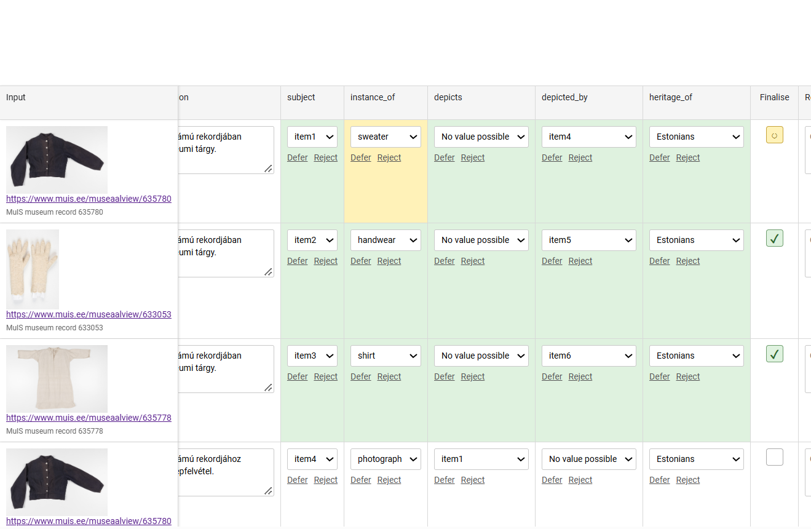
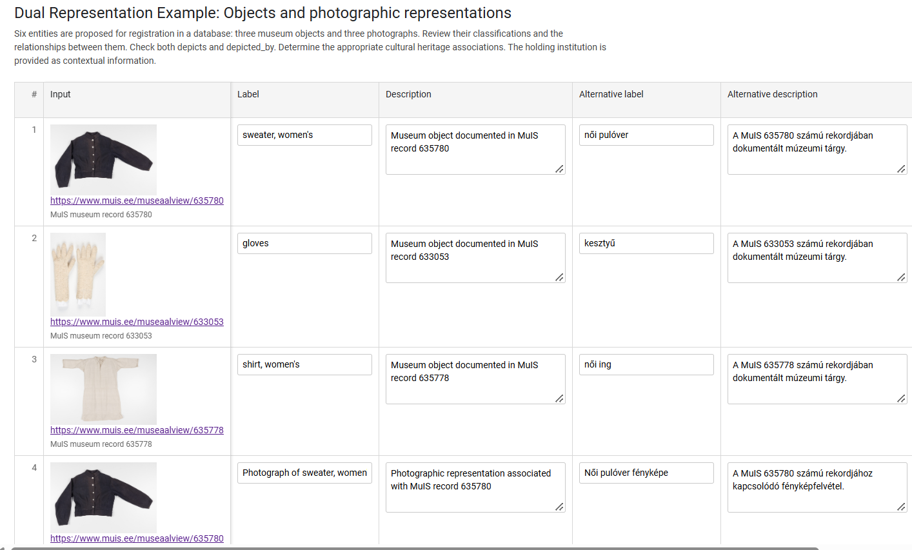

```{r, include=FALSE}
knitr::opts_chunk$set(
  collapse = TRUE,
  comment = "#>"
)
```

# Overview

A Betwixt review begins with a **candidate dataset**: a table containing proposed descriptions, classifications, and relationships that a reviewer can examine and, where necessary, correct.

You do not need to construct this table programmatically. You can prepare it in Microsoft Excel, LibreOffice Calc, or another spreadsheet editor.

This vignette demonstrates how to:

1.  Create an empty Betwixt candidate template.
2.  Populate the template with museum records in Excel.
3.  Describe six distinct entities using three museum records.
4.  Propose classifications and relationships for review.
5.  Import and validate the completed spreadsheet.
6.  Render a standalone HTML review.
7.  Understand what happens to the candidate assertions after review.

The example is based on three garment records from MuIS, the Estonian museum information system. For each record, we propose two entities: a physical museum object and a photographic representation of that object.

The exercise deliberately introduces a small semantic modelling problem. It is not simply about correcting labels. The reviewer must consider **what entities exist, what kinds of entities they are, and how they relate to one another**.

# Understand the example

We begin with three museum records.

| MuIS record | Object label     |
|:------------|:-----------------|
| 635780      | sweater, women's |
| 633053      | gloves           |
| 635778      | shirt, women's   |

Each record has an associated photographic image.

A museum object and a photograph of that object are not the same entity. The object is a physical heritage item; the photograph is a visual representation of that item.

For the purposes of this exercise, we therefore propose six entities:

| Subject | Proposed classification | Description                    |
|:--------|:------------------------|:-------------------------------|
| item1   | object                  | sweater, women's               |
| item2   | object                  | gloves                         |
| item3   | object                  | shirt, women's                 |
| item4   | photograph              | Photograph of sweater, women's |
| item5   | photograph              | Photograph of gloves           |
| item6   | photograph              | Photograph of shirt, women's   |

These are **candidate entities**. Their classifications and relationships are proposed for review, rather than treated as established facts.

The photographs and objects deliberately share their MuIS evidence URLs. This does not mean that they have the same identity. You will create a table like <https://usebetwixt.com/examples/tutorial/muis_dual_representation_example.html>.



## Relationships between the entities

In this example, you can create a dual review table that has representations and represented entities. We propose two reciprocal relationships.

1.  The property `depicts` describes what a photograph represents.
2.  The property `depicted_by` describes which photograph represents an object.

For the first garment:

```         
item1 -- depicted_by --> item4
item4 -- depicts -----> item1
```

The same pattern applies to the other two garments:

```         
item2 -- depicted_by --> item5
item5 -- depicts -----> item2

item3 -- depicted_by --> item6
item6 -- depicts -----> item3
```

The reviewer will be able to examine both directions independently. You could also create similar dual properties, like `derived_from` and `derivation`, for example, if you create a zoomed detail from a large photograph, or if you modify a media image.

**It is not necessary** to register dual relationships. In this tutorial, we just show that you can create such, richer representation when you need to. We also introduce `heritage_of`, a proposed cultural heritage association, which is not a dual property. Its candidate values are initially empty because the MuIS record identifiers and garment descriptions alone do not establish cultural affiliation.

# Create an empty spreadsheet template

First, load Betwixt.

```{r setup}
library(betwixt)
```

The function `create_candidate_template()` creates an empty table with the column names expected by Betwixt.

For this exercise, we need four reviewable properties:

- `instance_of`: the type or classification of the entity.
- `depicts`: the entity represented by a photograph.
- `depicted_by`: the photograph representing an entity.
- `heritage_of`: the cultural heritage association.

We also include `context_held_by`, which provides contextual information but is not itself a reviewable assertion.

```{r}
template <- create_candidate_template(
  input_label = FALSE,
  columns = c(
    "instance_of",
    "depicts",
    "depicted_by",
    "heritage_of"
  ),
  context = "context_held_by"
)

names(template)
```

The template contains column headers but no records.

Export it to Excel:

```{r eval=FALSE}
writexl::write_xlsx(
  template,
  "muis-dual-representation.xlsx"
)
```

Open `muis-dual-representation.xlsx` in Excel.

**Important:** Keep the column names unchanged. Do not insert explanatory rows above the headers or merge cells.

# Enter six candidate entities

Each row represents one entity proposed for registration in a database.

We need six rows because we are distinguishing three museum objects from three photographs.

The following blocks are designed for direct copying into Excel. Each block contains six lines, corresponding to rows 2–7 of the spreadsheet.

Paste the contents into the column named above each block, starting in the first data cell.

## Row identifiers

The `row_id` column identifies rows in the candidate dataset.

It is not a museum identifier and does not represent a semantic relationship.

**Column: `row_id`**

```         
1
2
3
4
5
6
```

Each row identifier must be a unique positive integer.

## Subject identifiers

The `subject` column identifies the entity about which assertions are being proposed.

In this example, we use short local identifiers. You can use here Wikidata QIDs, your local Wikibase QIDs, or any reference. If you use Betwixt to populate a future database, the best if you create placeholders like we do here with `item1` to `item6`

**Column: `subject`**

```         
item1
item2
item3
item4
item5
item6
```

The subject identifier is different from the row identifier. The row identifier identifies a table row; the subject identifies an entity.

In a production knowledge system, the local subject identifiers could subsequently be associated with persistent identifiers or IRIs.

## Descriptive labels

The `label` column contains the proposed human-readable label for each entity.

**Column: `label`**

```         
sweater, women's
gloves
shirt, women's
Photograph of sweater, women's
Photograph of gloves
Photograph of shirt, women's
```

The first three labels describe physical objects.

The final three labels describe their photographic representations.

These labels are candidate assertions. A reviewer may correct them.

## Descriptions

The `description` column contains a proposed textual description of each entity.

**Column: `description`**

```         
Museum object documented in MuIS record 635780
Museum object documented in MuIS record 633053
Museum object documented in MuIS record 635778
Photographic representation associated with MuIS record 635780
Photographic representation associated with MuIS record 633053
Photographic representation associated with MuIS record 635778
```

The descriptions are intentionally simple. They identify the documentary basis of the proposed entities without making additional claims about their origin, creators, or cultural affiliations.

## Alternative label and description

Betwixt allows you to provide alternative labels and descriptions for the same entity. This can be useful when preparing a database for different audiences, such as English and Hungarian speakers, museum curators, and exhibition visitors.

You can add either or both of the following columns to your Excel spreadsheet:

- `alternative_label` — an alternative name or short label for the entity.

- `alternative_description` — an alternative textual description of the entity.

For example, a museum object labelled *sweater, women's* might have the Hungarian alternative label *női pulóver*. Similarly, its English description could be accompanied by a Hungarian description intended for museum visitors.



To include these properties, simply add one or two columns with the exact headers `alternative_label` and `alternative_description`. Enter the alternative values in the corresponding rows. You do not need to change any other columns.

Both columns are optional. You can use either one independently, use both, or leave individual cells empty when no alternative is available.

Like `label` and `description`, these columns contain **candidate assertions**. They are included in the Betwixt review so that reviewers can examine and correct the proposed alternative wording. The original labels and descriptions remain separate.

# Add documentary evidence

A candidate assertion should be accompanied by evidence that the reviewer can inspect.

Betwixt distinguishes the source of an observation from the assertion proposed on the basis of that source.

In our example:

- `input_url` links to the MuIS museum record.
- `input_media_url` provides a photograph for visual inspection.
- `input_description` identifies the source record.

The same evidence may support more than one candidate entity.

## Source record URLs

**Column: `input_url`**

```         
https://www.muis.ee/museaalview/635780
https://www.muis.ee/museaalview/633053
https://www.muis.ee/museaalview/635778
https://www.muis.ee/museaalview/635780
https://www.muis.ee/museaalview/633053
https://www.muis.ee/museaalview/635778
```

Notice that the first and fourth rows have the same source URL. We are talking about the same thing, but first about the photographed object, then about the photograph itself. You would do something similar with derived objects, for example.

These dual representes refer to different proposed entities (i.e. a textile garment and photograph), but both are supported by the same MuIS record.

## Photographic evidence

**Column: `input_media_url`**

```         
https://www.muis.ee/digitaalhoidla/api/meedia/pisipilt?id=ebc07930-f719-44f2-a108-6698bcecc20b
https://www.muis.ee/digitaalhoidla/api/meedia/pisipilt?id=6440f24f-eaad-4cd4-84d7-1ae7a9d44d5a
https://www.muis.ee/digitaalhoidla/api/meedia/pisipilt?id=826c402e-c130-4860-b11e-9538bd403ecf
https://www.muis.ee/digitaalhoidla/api/meedia/pisipilt?id=ebc07930-f719-44f2-a108-6698bcecc20b
https://www.muis.ee/digitaalhoidla/api/meedia/pisipilt?id=6440f24f-eaad-4cd4-84d7-1ae7a9d44d5a
https://www.muis.ee/digitaalhoidla/api/meedia/pisipilt?id=826c402e-c130-4860-b11e-9538bd403ecf
```

These URLs provide the images displayed in the HTML review. Betwixt supports local review files, and you can also add here simply your local files, like `images/myimage1.jpg`.

An image is evidence for the proposed assertions, not proof that those assertions are correct.

## Source descriptions

**Column: `input_description`**

```         
MuIS museum record 635780
MuIS museum record 633053
MuIS museum record 635778
MuIS museum record 635780
MuIS museum record 633053
MuIS museum record 635778
```

The `input_description` identifies the evidence. The `description` column, entered earlier, describes the proposed entity.

This distinction is important: documentary observations and semantic assertions are different things. The source can be a reliable library, museum catalogue, your own collection or work.

# Enter the proposed classifications

We now begin entering the assertions that will be reviewed.

Each reviewable property may have three related columns:

| Column                | Purpose                                   |
|:----------------------|:------------------------------------------|
| `property`            | Proposed value                            |
| `property_range`      | Available choices for review              |
| `property_definition` | Optional semantic definition or reference |

The `_range` and `_definition` columns support the review. They are not additional assertions about the subject.

## Classification with `instance_of`

The `instance_of` property describes what kind of entity each subject is.

**Column: `instance_of`**

```         
object
object
object
photograph
photograph
photograph
```

We have deliberately used broad classifications. The reviewer may decide that a more specific classification is appropriate. For example, `item2` could be classified as `handwear` rather than the general category `object`.

## Define the available classifications

The `instance_of_range` column provides possible choices for the reviewer.

For this exercise, use:

```         
object | shirt | handwear | sweater | drawing | photograph | other
```

Copy this complete string into all six cells of the `instance_of_range` column.

The pipe character (`|`) separates alternatives.

The special value `other` allows the reviewer to propose a value outside the predefined list. The range is not an assertion that all listed classifications are correct. It is a set of choices offered during review.

Leave `instance_of_definition` empty for this exercise.

# Describe the dual relationships

The next two properties describe the relationships between objects and photographs.

## The `depicts` property

The `depicts` property identifies the entity represented by a photograph.

**Column: `depicts`**

```         
No value possible
No value possible
No value possible
item1
item2
item3
```

The first three entities are museum objects, not photographs.

In this example, the proposed value `No value possible` indicates that the property is not applicable to those entities in the intended model. In our model, only a photograph depicts something. If the item is a glove or a shirt, it does not depict, it is depicted by the photograph.

For the photographs, the values identify the represented objects. The reviewer may confirm or correct these proposals.

**Column: `depicts_range`**

Copy the following complete string into all six cells:

```         
item1 | item2 | item3 | No value possible | other
```

Leave `depicts_definition` empty.

## The `depicted_by` property

The reciprocal property `depicted_by` identifies a photograph representing an entity.

**Column: `depicted_by`**

```         
item4
item5
item6
No value possible
No value possible
No value possible
```

The first three entities are represented by photographs.

The final three entities are themselves photographs, so this exercise proposes `No value possible` for their `depicted_by` values.

**Column: `depicted_by_range`**

Copy the following complete string into all six cells:

```         
item4 | item5 | item6 | No value possible | other
```

Leave `depicted_by_definition` empty.

## Why review both directions?

The two relationships are logically related, but the candidate dataset records them separately.

For example:

```         
item1 -- depicted_by --> item4
item4 -- depicts -----> item1
```

If a reviewer changes one relationship, the other should also be examined.

Betwixt does not need to assume that every candidate relationship is correct merely because its reciprocal relationship has also been proposed.

This illustrates a general principle of semantic review: related assertions may be checked independently, while their consistency can be assessed as part of the review process.

# Review cultural heritage associations

The `heritage_of` property introduces a different type of review question.

A museum record may describe an object without providing sufficient evidence to determine its cultural heritage affiliation.

We should not infer that an object belongs to Estonian cultural heritage merely because it appears in an Estonian museum information system.

For this reason, all six candidate values are initially missing.

**Column: `heritage_of`**

Leave all six cells empty.

**Column: `heritage_of_range`**

Copy the following string into all six cells:

```         
Estonians | Livonians | Latvians | No value possible | Value unknown | other
```

Leave `heritage_of_definition` empty.

## Missing values and review choices

There is an important difference between an empty candidate cell and an explicit statement about the availability of a value.

An empty candidate cell means that no value has been supplied.

`Value unknown` expresses that the value is applicable but not known.

`No value possible` expresses that the property has no applicable value.

The option `other` allows the reviewer to propose a value not listed among the available alternatives.

In this example, `No value possible` and `Value unknown` are included as explicit choices in the candidate ranges. Their precise semantic handling depends on the review implementation; they should not be confused with ordinary empty cells.

# Add contextual information

Some information may be useful to display without making it a reviewable assertion.

The `context_held_by` column demonstrates this possibility. Every column that you may add later in Excel or Google Spreadsheets or a similar application that start `context_` will be displayed but not subject to revision by the reviewer.

**Column: `context_held_by`**

```         
Estonian National Museum
Estonian National Museum
Estonian National Museum
Estonian National Museum
Estonian National Museum
Estonian National Museum
```

This is illustrative contextual information for the exercise, not a verified attribution of these three records to the Estonian National Museum.

Unlike `instance_of` or `heritage_of`, the `context_held_by` column is not accompanied by `_range` or `_definition` columns, because its value cannot be changed during the use of the review table. It is displayed as context rather than offered for review.

# Define the subject range

The `subject_range` column provides the possible subject identifiers for review.

Copy the following string into all six cells:

```         
item1 | item2 | item3 | item4 | item5 | item6 | other
```

Leave `subject_definition` empty.

At this point, the spreadsheet contains six candidate entities and four reviewable properties.

Save the workbook.

# Import the completed spreadsheet into R

Return to R.

The `readxl` package can import the Excel workbook without requiring Microsoft Excel to be installed.

```{r eval=FALSE}
candidates <- readxl::read_excel(
  "muis-dual-representation.xlsx",
  col_types = "text"
)

candidates$row_id <- as.integer(candidates$row_id)
```

Reading the columns as text prevents identifiers and URLs from being inadvertently converted into numeric or date values.

The `row_id` column is then explicitly converted to integer.

You can inspect the imported data:

```{r eval=FALSE}
dplyr::glimpse(candidates)

candidates[, c(
  "row_id",
  "subject",
  "instance_of",
  "depicts",
  "depicted_by",
  "heritage_of"
)]
```

The result should contain six rows.

# Validate the candidate dataset

Before rendering the review, validate the imported table.

```{r eval=FALSE}
validate_candidate_dataset(candidates)
```

Validation checks whether the table satisfies the structural requirements of a Betwixt candidate dataset.

These include:

- A `row_id` column containing unique positive integers.
- A `subject` column.
- Appropriate character values in descriptive columns.
- Correctly paired assertion, range, and definition columns.

Validation is not semantic verification.

It does not establish whether a museum object has been correctly classified, whether a photograph represents the proposed object, or whether the cultural heritage association is justified.

Those are questions for review.

# Render a standalone HTML review

After successful validation, the candidate dataset can be rendered as a standalone HTML document.

```{r eval=FALSE}
render_review(
  candidates,
  title = "Exercise 7: Objects and photographic representations",
  description = paste(
    "Six entities are proposed for registration in a database:",
    "three museum objects and three photographs.",
    "Review their classifications and the relationships between them.",
    "Check both depicts and depicted_by.",
    "Determine the appropriate cultural heritage associations.",
    "The holding institution is provided as contextual information."
  ),
  reviewer_name = "",
  reviewer_iri = "",
  table_id = "muis_dual_representation_example",
  row_comment = TRUE,
  review_comment = TRUE,
  filename_stem = "muis_dual_representation_example",
  path = "."
)
```

The resulting HTML document can be opened in a browser.

The reviewer can inspect the photographic evidence, open the MuIS source records, review proposed values, enter corrections, and record comments.

The reviewer does not need to use R or Excel to complete the review.

# Understand the review lifecycle

The spreadsheet represents the **candidate state**.

The HTML review introduces a separate reviewed state.

This distinction is fundamental to Betwixt: the reviewer does not silently overwrite the original candidate assertions.

For example, a candidate classification might be:

```         
item2 -- instance_of --> object
```

A reviewer may propose a more specific classification:

```         
item2 -- instance_of --> handwear
```

The original candidate and the reviewed assertion can both be retained.

The review may also record whether an assertion was corroborated, corrected, rejected, or deferred, together with associated comments and provenance.

A saved review can be reopened and continued. Finalisation marks the review activity as complete.

# Read the completed review into R

After finalisation, the HTML review can be imported into R.

The exact filename depends on the output generated during review.

For example:

```{r eval=FALSE}
completed <- read_review(
  "muis_dual_representation_example_1-finalised.html"
)

completed$candidate
completed$reviewed
completed$provenance
```

The candidate and reviewed states remain distinct.

Betwixt also provides projections of the reviewed information:

```{r eval=FALSE}
wide <- project_review_wide(completed)

long <- project_review_long(completed)
```

The wide representation aligns candidate, reviewed, and status information.

The long representation expresses individual assertions and their review states in a more normalised structure.

Finalising a review does not automatically modify MuIS or another external knowledge system.

# Candidate provenance

Preparing a candidate dataset and reviewing its assertions are two different activities.

The person preparing the spreadsheet may select records, introduce entity identifiers, propose classifications, and construct relationships.

A reviewer may subsequently confirm or challenge those proposals.

These activities should not be confused.

A plain Excel workbook contains the candidate table, but does not automatically provide the dataset-level preparation provenance that may be attached through a programmatic candidate-dataset workflow.

For reproducible work, it is useful to record:

- Who prepared the candidate dataset.
- Which source records were used.
- When the candidate dataset was prepared.
- Which modelling decisions were made before review.

The MuIS example demonstrates why this matters. The decision to represent three museum records as six entities is itself a modelling decision made during candidate preparation.

The reviewer is being asked to evaluate that proposal, not merely transcribe information from the museum records.

# Conclusion

This vignette has demonstrated how to prepare a Betwixt candidate dataset in Excel without constructing the records programmatically.

Starting from three museum records, we created six candidate entities, supplied documentary evidence, proposed classifications, described reciprocal relationships, and left cultural heritage associations open for review.

The completed spreadsheet can be validated in R and rendered as a standalone HTML review.

The essential distinction is between **evidence, candidate assertions, contextual information, and reviewed assertions**.

Excel provides an accessible environment for preparing the candidate state. Betwixt provides the structured review workflow that preserves the distinction between the original proposals and subsequent decisions.
